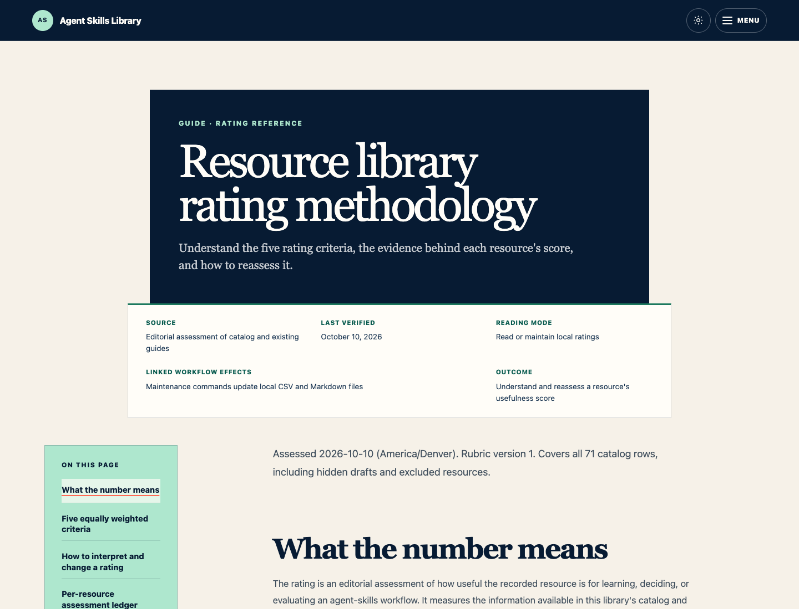
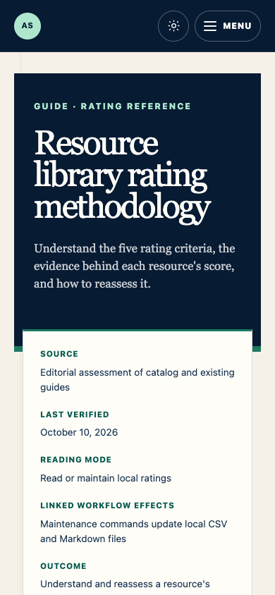
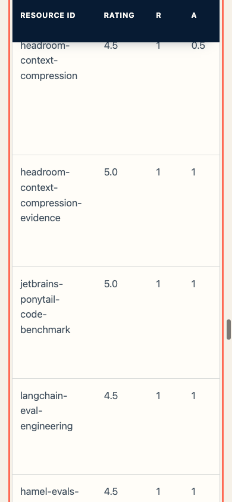
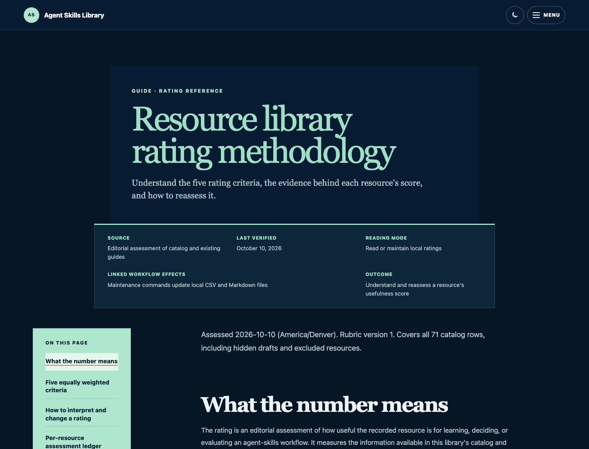

# Resource ratings guide verification

Verified October 11, 2026, for the ratings-guide addition to PR #16.

The library's **Rating criteria** link now opens `/guides/resource-ratings` as
HTML. The searchable Guides index includes the same page. The guide uses the
shared hero, trust receipt, unnumbered contents, reading layout, reference
links, and native table scroll regions. Its source remains the generated
`public/data/resource-ratings.md`; its sibling JSON link resolves under the
site's configured base path. No CSV rows or rating assessments changed in
this follow-up.

## Automated validation

- `npm test`: 61 passed, 0 failed, 1 optional external-link check skipped.
- `npm run lint`: 0 errors; the same 3 existing warnings.
- `NEXT_PUBLIC_BASE_PATH=/agent-skills-resource-library NEXT_PUBLIC_SITE_URL=https://joeywilkes12.github.io npm run build:pages`: successful static export, including the new route.
- Added HTML checks for the library and index links, guide headings, contents
  anchors, trust receipt, JSON download, five criteria, and all 71 assessment
  rows with nine column headers. The guide's own links are included in the
  local link-integrity checks.
- Independent local code review found no actionable issues.

## Browser verification

Tested both the Next.js localhost application and the static export served
locally with the actual `/agent-skills-resource-library` URL prefix.

- Clicking **Rating criteria** opens the HTML guide; searching the Guides
  index for `rating criteria` finds and opens it.
- The criteria table has 4 columns and 5 rows. The assessment ledger has
  9 columns and 71 rows. The prefixed JSON download returns HTTP 200 and
  contains 71 assessments.
- At 390px, the ledger has a 348px scroll region and 924px content width.
  Focusing it and pressing the right arrow scrolls it horizontally while the
  document stays within the viewport.
- The sticky header appears while the table crosses the viewport and releases
  at the table boundary. Its visual copy is hidden from assistive technology.
- No horizontal page overflow at 320px, 720px, or 1440px. A 200% desktop-zoom
  equivalent (720 CSS pixels at device-pixel ratio 2) also stays within the
  viewport.
- Light and dark screenshots inspected. No browser runtime errors observed.

## Screenshots

Captured from the local production export, with no development toolbar.

